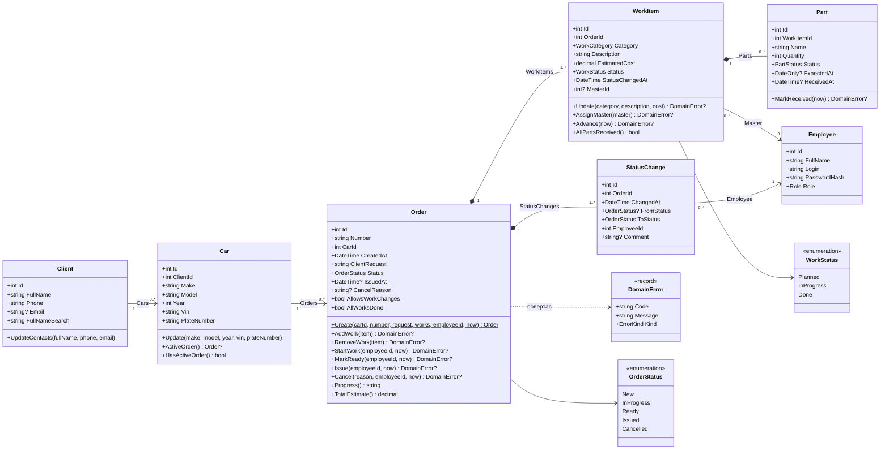
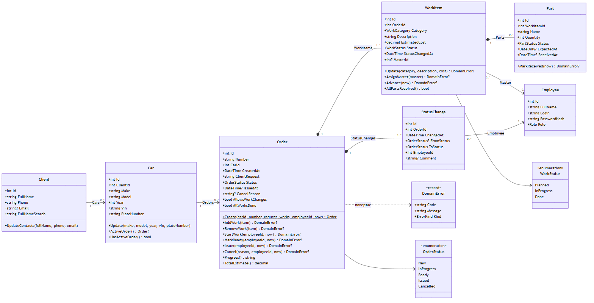
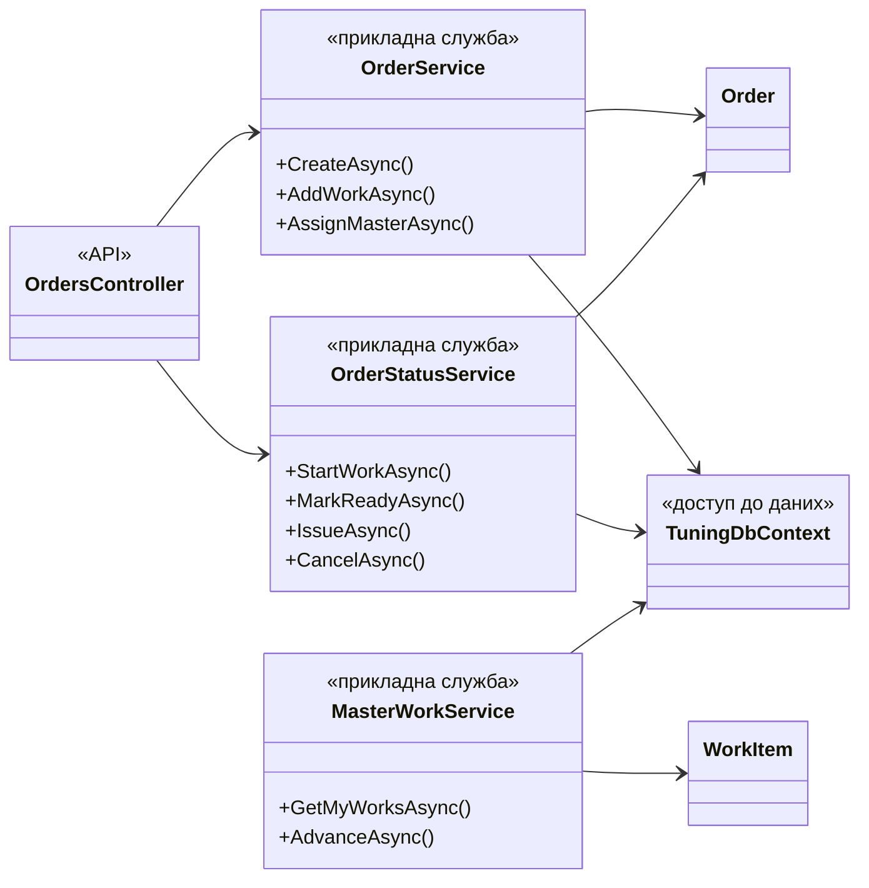
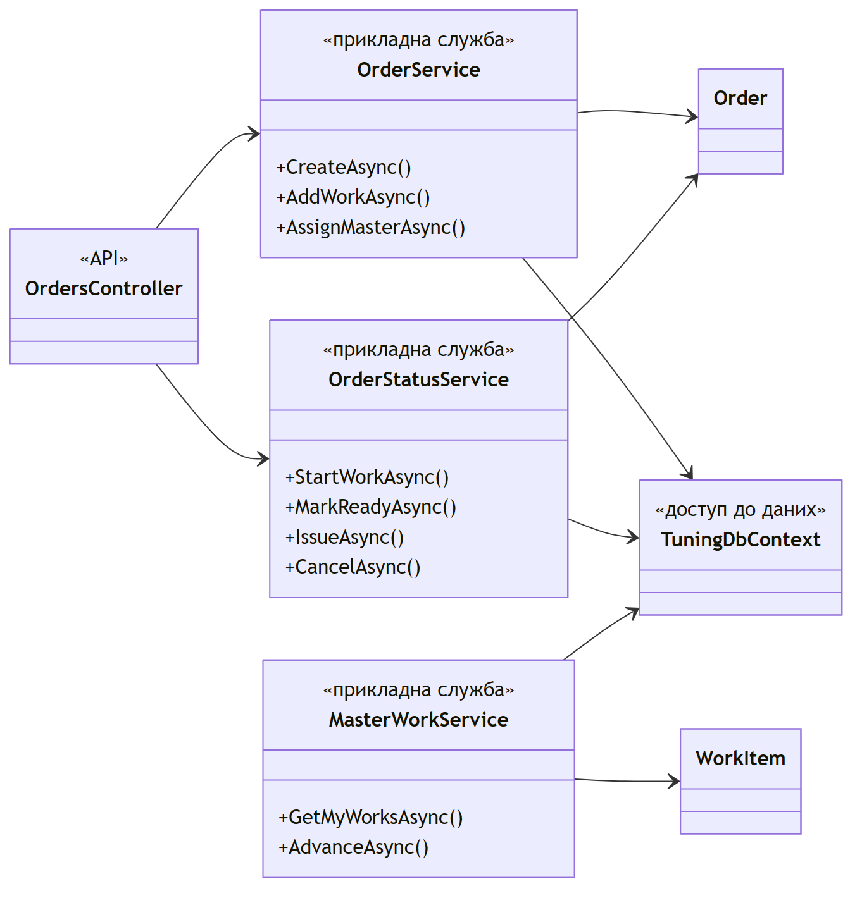

# Фактична діаграма класів v1.0

Командна модель статичної структури, побудована за інтегрованим кодом `main` після ЛР №4 (зворотне проєктування вручну: оголошення класів, типи членів, конфігурація [`TuningDbContext`](../../backend/src/TuningShop.Api/Data/TuningDbContext.cs)). Проєктна модель ЛР №3 залишається без змін: [docs/model/class-diagram.puml](../model/class-diagram.puml), [зображення](../docs/images/class-diagram.png).

## Предметні класи

Показано суттєві члени предметного шару ([backend/src/TuningShop.Api/Domain](../../backend/src/TuningShop.Api/Domain)). Ідентифікатори й зовнішні ключі включено, бо вони визначають кратності; навігаційні властивості показано зв'язками. Видимість `+` — загальнодоступні члени; усі властивості мають приватні сетери, стан змінюється лише операціями класу.

*Рисунок 1 — Фактична діаграма предметних класів v1.0 (джерело — блок Mermaid вище). Переліки `PartStatus`, `WorkCategory`, `Role` і запис `ErrorKind` опущено: їхні значення збігаються з проєктною моделлю.*

Кратності підтверджено конфігурацією `TuningDbContext`: зовнішні ключі `Car.ClientId`, `Order.CarId`, `WorkItem.OrderId`, `Part.WorkItemId`, `StatusChange.OrderId` і `StatusChange.EmployeeId` обов'язкові (1), `WorkItem.MasterId` — необов'язковий (0..1). Композиції `Order–WorkItem`, `Order–StatusChange` і `WorkItem–Part` реалізовано каскадним видаленням; нижню межу «1..*» для робіт забезпечує `Order.Create` (виняток без робіт) і `Order.RemoveWork` (відмова `last_work`), а для історії — перший запис, який `Order.Create` додає разом із замовленням.

## Як шари використовують предметні класи

*Рисунок 2 — Залежності між шарами на прикладі замовлень. Решта служб (`ClientService`, `CarService`, `OrderQueryService`, `PartService`, `TrackingService`, `AuthService`) побудована так само: контролер → служба → `TuningDbContext` і предметні класи. Клієнт Next.js звертається лише до маршрутів API.*

## Порівняння з проєктною моделлю ЛР №3

| Елемент | Проєктна модель ЛР №3 | Фактична реалізація | Відповідність / причина відмінності |
| --- | --- | --- | --- |
| Склад класів | Client, Car, Order, WorkItem, Part, Employee, StatusChange, 5 переліків | Ті самі 7 класів і 5 переліків | Відповідає |
| Ідентифікатори | Службові ідентифікатори не моделювались | `Id` і зовнішні ключі в кожному класі | Потрібні для зберігання в реляційній БД; на проєктній діаграмі свідомо опущені (design.md) |
| Client.updateContacts(phone, email) | Змінює телефон і e-mail | `UpdateContacts(fullName, phone, email)` | FR-03 дозволяє редагувати всі дані клієнта, зокрема ПІБ |
| Client.FullNameSearch | — | ПІБ у нижньому регістрі | Технічне поле для пошуку за частиною ПІБ без урахування регістру: `LIKE` у SQLite не нормалізує кирилицю (FR-18) |
| Car.hasActiveOrder() | Є | `HasActiveOrder()` і `ActiveOrder()` | `ActiveOrder()` повертає замовлення, щоб показати його номер в альтернативі A2 UC-03 |
| Order.addWork / startWork / markReady / issue / cancel | Операції без результату | Повертають `DomainError?` | Предметна відмова — очікуваний результат, а не виняток: служба передає її клієнту як 409/400, дані не змінюються |
| Order.progress(), totalEstimate() | Є | `Progress()`, `TotalEstimate()`, а також `DoneCount`, `AllWorksDone`, `AllowsWorkChanges` | `AllWorksDone` реалізує позначку «усі роботи виконано» (UC-05, крок 9); `AllowsWorkChanges` — внутрішні дії станів «Нове» і «В роботі» |
| Order.removeWork | — | `RemoveWork(item)` | Правило «не залишати замовлення без робіт» (FR-07) віднесено до замовлення, яке володіє роботами |
| WorkItem.advanceStatus() | Є | `Advance(now)` | Час зміни передається явно для відтворюваних перевірок (`TimeProvider`) |
| WorkItem.update | — | `Update(category, description, cost)` | Редагування лише запланованої роботи (FR-07) |
| WorkItem.addPart(part) | Є | Колекція `Parts`; перевірку стану замовлення виконує `PartService` | Деталь додається через навігацію EF Core; умова «замовлення Нове/В роботі» потребує завантаженого замовлення, тому перевіряється в службі |
| Part.markReceived() | Є | `MarkReceived(now)` з відмовою при повторній відмітці | Відповідає; повторна відмітка не змінює час надходження |
| Employee | fullName, login, role | Також `PasswordHash` | NFR-02: зберігається лише хеш |
| StatusChange | changedAt, fromStatus, toStatus, comment, автор | Те саме; автор — `EmployeeId` | Відповідає; коментар містить причину скасування |
| Кратності | Client 1–0..* Car; Car 1–0..* Order; Order ◆ 1..* WorkItem, ◆ 1..* StatusChange; WorkItem ◆ 0..* Part; WorkItem 0..* – 0..1 Employee; Employee 1 – 0..* StatusChange | Ті самі | Відповідає; підтверджено конфігурацією `TuningDbContext` |
| DomainError | — | Новий запис | Тип результату предметних операцій (лекція №5: предметна відмова відокремлена від інфраструктурного збою) |

Висновок: статична структура реалізації відповідає проєктній моделі ЛР №3; відмінності стосуються технічних полів зберігання, явної передачі часу й способу повернення предметних відмов і не змінюють вимог, сценаріїв чи станів. Погоджувати зміну проєкту не потрібно.

---

[Діаграми послідовності учасників](sequences/) · [Матриця простежуваності](../docs/traceability.md)
