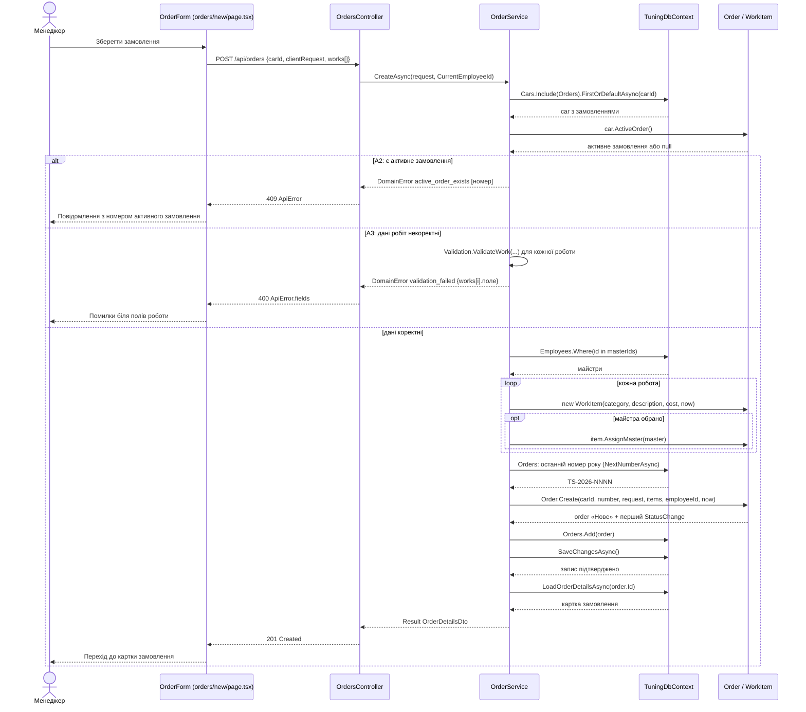
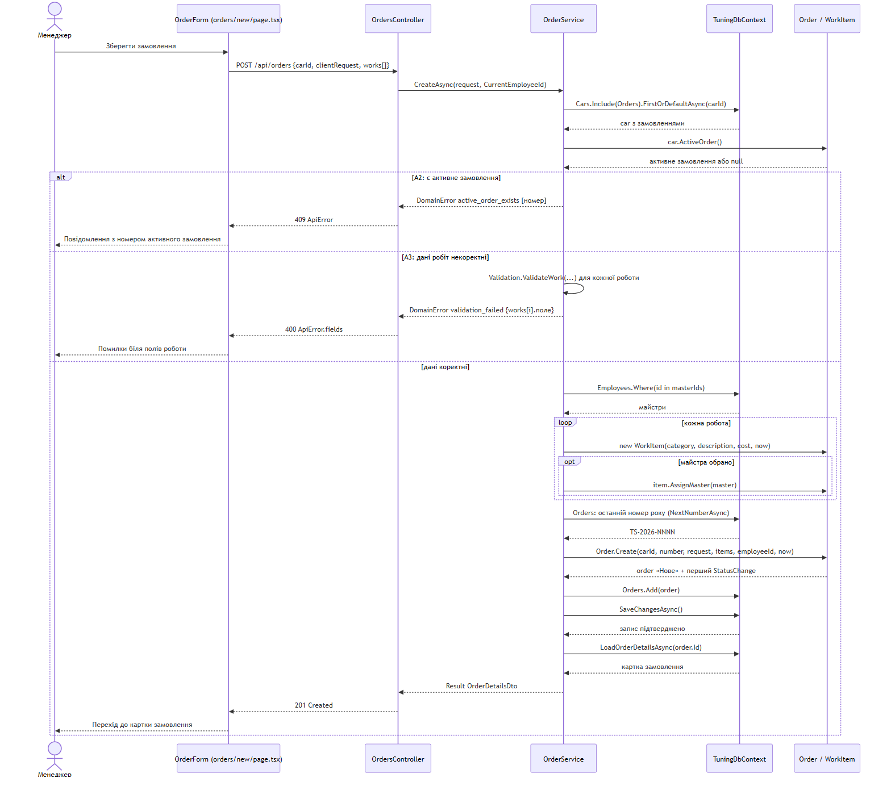

# Діаграма послідовності UC-03 «Оформити замовлення»

Учасник: Антропов Володимир. Сценарій призначено в ЛР №3 ([use-cases.md](../../docs/use-cases.md#uc-03-оформити-замовлення), [Activity UC-03](../../docs/activity-UC-03.md)).
Модель побудовано за інтегрованим кодом після злиття; показано дію «Зберегти замовлення» (кроки 4–12) з альтернативами A2 і A3.

*Рисунок 1 — Діаграма послідовності «Оформити замовлення» за фактичним кодом.*

Порядок у коді відповідає діаграмі: перевірка активного замовлення (A2) виконується до перевірки даних робіт (A3), як на Activity UC-03, де рішення «Є активне замовлення?» передує додаванню робіт. В обох альтернативах `SaveChangesAsync` не викликається, тож база не змінюється. Альтернатива A1 (автомобіль не знайдено) і крок 1 (пошук, UC-11) виконуються раніше, на сторінці пошуку, окремими запитами `GET /api/cars?query=`. Попередження A4 (робота без майстра) клієнт показує до відправлення, а сервер зберігає роботу з `MasterId = null`.

## Досліджені шляхи коду

| Стрілка | Файл і метод |
| --- | --- |
| Зберегти замовлення → POST | [frontend/app/orders/new/page.tsx:83](../../../frontend/app/orders/new/page.tsx#L83) `submit` |
| POST → CreateAsync | [OrdersController.cs:29](../../../backend/src/TuningShop.Api/Controllers/OrdersController.cs#L29) `Create`; відповідь — [ApiControllerBase.cs:17](../../../backend/src/TuningShop.Api/Controllers/ApiControllerBase.cs#L17) `Respond` |
| CreateAsync, A2, A3, майстри, номер, Add, SaveChangesAsync | [OrderService.cs:12](../../../backend/src/TuningShop.Api/Application/OrderService.cs#L12) `CreateAsync` (A2 — рядок 25, майстри — 37, `Order.Create` — 55, запис — 57) |
| ActiveOrder | [Car.cs](../../../backend/src/TuningShop.Api/Domain/Car.cs) `ActiveOrder` |
| new WorkItem, AssignMaster | [WorkItem.cs](../../../backend/src/TuningShop.Api/Domain/WorkItem.cs) |
| Order.Create, перший StatusChange | [Order.cs:24](../../../backend/src/TuningShop.Api/Domain/Order.cs#L24) |
| LoadOrderDetailsAsync | [OrderDetailsLoader.cs:10](../../../backend/src/TuningShop.Api/Application/OrderDetailsLoader.cs#L10) |

## Критерії приймання й перевірки

| Критерій | Перевірка | Результат |
| --- | --- | --- |
| AC-06 | `OrderServiceTests.AC06_OrderSaved_WithNumberDateStatusAndHistory_AppearsInCurrent`, `AC06_SecondActiveOrder_NotCreated_ShowsActiveNumber`, `AC06_AfterCancel_NewOrderAllowed_WithNextNumber`; UI: AC-06/07, AC-06 | Пройдено |
| AC-07 | `AC07_InvalidWork_MarkedByField_NothingSaved`, `AC07_AddWork_OnlyForNewOrInProgress`, `AC07_StartedOrDoneWork_CannotBeEditedOrDeleted_LastWorkCannotBeDeleted` | Пройдено |
| AC-08 | `AC08_AssignMaster_OnlyMasterRole_OnlyPlannedWork`, `A4_WorkWithoutMaster_IsSaved_ButCannotStartWork`; UI: AC-08/09 | Пройдено |

Звірку стрілок із кодом виконує незалежний перевіряльник у запиті на злиття документації: _перевіряльник — визначається під час розподілу ролей_.
