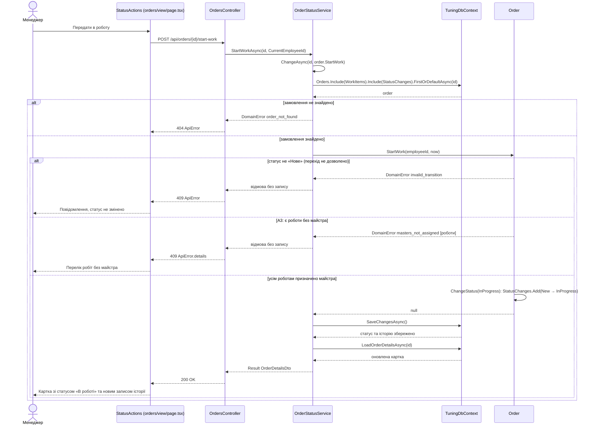
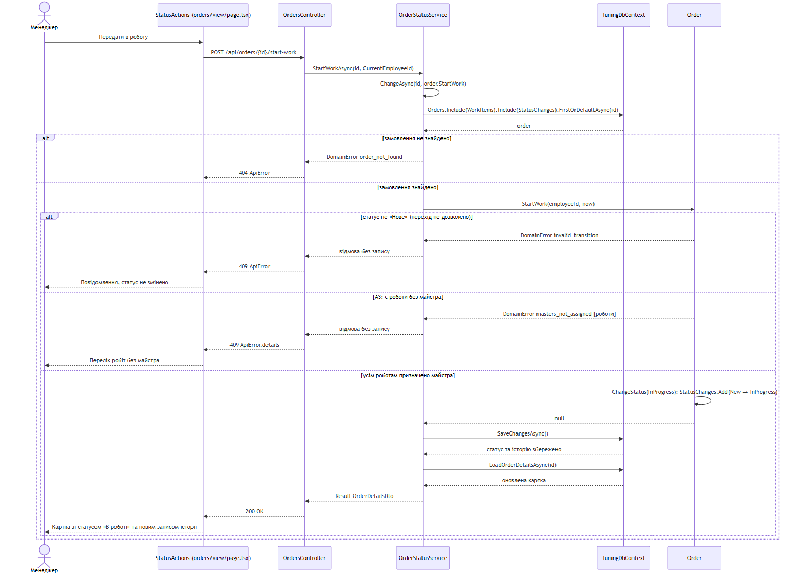

# Діаграма послідовності UC-04 «Змінити статус замовлення»

Учасник: Курицький Орест. Сценарій призначено в ЛР №3 ([use-cases.md](../../docs/use-cases.md#uc-04-змінити-статус-замовлення), [Activity UC-04](../../docs/activity-UC-04.md)).
Модель побудовано за інтегрованим кодом; показано дію «Передати в роботу» (кроки 3–7) з альтернативами A1/A3. Інші переходи («Позначити готовим», «Видати автомобіль», «Скасувати») проходять той самий шлях із відповідним методом `Order`.

*Рисунок 1 — Діаграма послідовності «Передати в роботу» за фактичним кодом.*

Рішення про допустимість переходу ухвалює предметний клас `Order`, а не служба чи обробник маршруту. Служба лише завантажує замовлення та підтверджує запис. При відмові `SaveChangesAsync` не викликається, тому статус та історія залишаються незмінними (постумова «Невдача» UC-04, AC-15). Альтернатива A1 (фінальний статус) на клієнті відображається відсутністю кнопок дій (`allowedActions` порожній). Якщо запит усе ж надійде, сервер відповість `invalid_transition`. Для «Скасувати» (A2) служба викликає `Order.Cancel(reason, …)`: порожня причина повертає `validation_failed` з полем `reason`.

## Досліджені шляхи коду

| Стрілка | Файл і метод |
| --- | --- |
| Передати в роботу → POST | [frontend/app/orders/view/page.tsx:42](../../../frontend/app/orders/view/page.tsx#L42) `StatusActions`, `apply` — [рядок 245](../../../frontend/app/orders/view/page.tsx#L245) |
| POST → StartWorkAsync | [OrdersController.cs:39](../../../backend/src/TuningShop.Api/Controllers/OrdersController.cs#L39) `StartWork` |
| StartWorkAsync → ChangeAsync → завантаження, перехід, запис | [OrderStatusService.cs:14](../../../backend/src/TuningShop.Api/Application/OrderStatusService.cs#L14), `ChangeAsync` — [рядок 26](../../../backend/src/TuningShop.Api/Application/OrderStatusService.cs#L26) (перехід — 36, запис — 39) |
| StartWork, ChangeStatus | [Order.cs:78](../../../backend/src/TuningShop.Api/Domain/Order.cs#L78), [Order.cs:124](../../../backend/src/TuningShop.Api/Domain/Order.cs#L124) |

## Критерії приймання й перевірки

| Критерій | Перевірка | Результат |
| --- | --- | --- |
| AC-09 | `OrderStatusServiceTests.AC09_StartWork_AllMastersAssigned_StatusChanged`, `AC09_StartWork_WorkWithoutMaster_NotChanged_ListShown`; UI: AC-09, AC-08/09 | Пройдено |
| AC-12 – AC-14 | `AC12_*`, `AC13_*`, `AC14_*`; модульна матриця `Transition_FollowsStateMachine` (20 переходів) | Пройдено |
| AC-15 | `AC15_EachSuccessfulChange_AddsExactlyOneHistoryRecord`; UI: AC-15 | Пройдено |

Звірку стрілок із кодом виконує незалежний перевіряльник у запиті на злиття документації: _перевіряльник — визначається під час розподілу ролей_.
