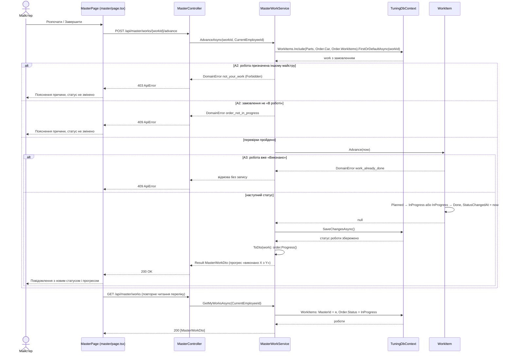
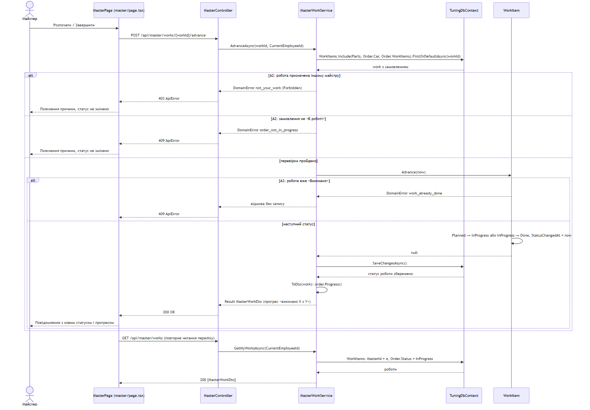

# Діаграма послідовності UC-05 «Виконати призначену роботу»

Учасник: Таценко Андрій. Сценарій призначено в ЛР №3 ([use-cases.md](../../docs/use-cases.md#uc-05-виконати-призначену-роботу), [Activity UC-05](../../docs/activity-UC-05.md)).
Модель побудовано за інтегрованим кодом; показано зміну статусу роботи (кроки 4–9) з альтернативами A2 і A3.

*Рисунок 1 — Діаграма послідовності «Виконати призначену роботу» за фактичним кодом.*

Крок 9 UC-05 (перевірка умови UC-04) не потребує окремого запису: ознака `AllWorksDone` обчислюється з робіт замовлення під час читання списку поточних замовлень. Менеджер бачить позначку «усі роботи виконано» і переводить замовлення в «Готове до видачі» (UC-04). Деталі роботи (крок 3, UC-09) повертаються в тому самому `MasterWorkDto` лише для перегляду. Альтернативу A1 (немає призначених робіт) клієнт показує як порожній перелік.

## Досліджені шляхи коду

| Стрілка | Файл і метод |
| --- | --- |
| Розпочати / Завершити → POST, повторне читання | [frontend/app/master/page.tsx:19](../../../frontend/app/master/page.tsx#L19) `advance` |
| POST → AdvanceAsync | [MasterController.cs:17](../../../backend/src/TuningShop.Api/Controllers/MasterController.cs#L17) `Advance` |
| AdvanceAsync: A2, Advance, SaveChangesAsync | [MasterWorkService.cs:27](../../../backend/src/TuningShop.Api/Application/MasterWorkService.cs#L27) (A2 — рядки 37 і 39, перехід — 42, запис — 45) |
| Advance | [WorkItem.cs:55](../../../backend/src/TuningShop.Api/Domain/WorkItem.cs#L55) |
| GetMyWorksAsync | [MasterWorkService.cs:12](../../../backend/src/TuningShop.Api/Application/MasterWorkService.cs#L12) |

## Критерії приймання й перевірки

| Критерій | Перевірка | Результат |
| --- | --- | --- |
| AC-10 | `MasterAndPartsTests.AC10_MasterSeesOnlyOwnWorks_FromInProgressOrders`; UI: AC-10 | Пройдено після виправлення DEF-01 |
| AC-11 | `AC11_AdvanceOwnWork_TimeSaved_ProgressUpdated`, `AC11_ForeignWork_OrderNotInProgress_OrBackwards_Rejected`; модульна `Work_AdvancesOnlyForward`; UI: AC-11/19 | Пройдено |
| AC-19 | прогрес у картці після оновлення — `AC11_AdvanceOwnWork_TimeSaved_ProgressUpdated` | Пройдено |

Звірку стрілок із кодом виконує незалежний перевіряльник у запиті на злиття документації: _перевіряльник — визначається під час розподілу ролей_.
